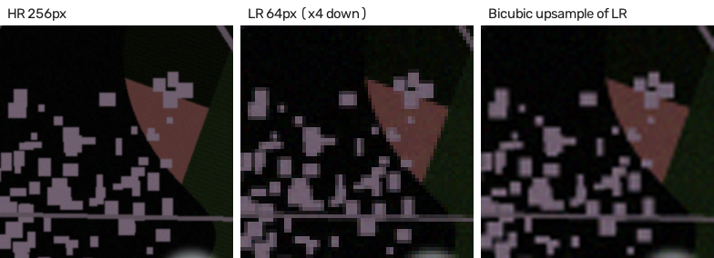
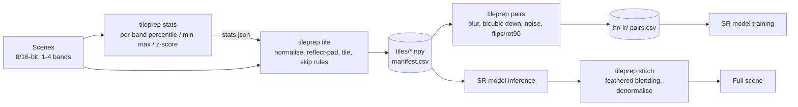

# satellite-tile-prep

[](https://github.com/RutuK2005/satellite-tile-prep/actions/workflows/ci.yml)  [](LICENSE)

A preprocessing toolkit that turns large satellite scenes into training data for
super-resolution (SR) models. It loads 8- or 16-bit images with 1-4 bands, normalises
each band (percentile clipping, min-max or z-score) and saves the stats so inference
uses the same transform. It then cuts the scene into overlapping tiles and skips tiles
that are mostly nodata, cloud or featureless. From the HR tiles it makes matched
low-/high-resolution pairs by blur + bicubic downsampling. After a model has processed
the tiles, it stitches them back into a full scene with feathered blending so the
seams don't show. Every tile ends up in a `manifest.csv`, so you can see what was kept
or skipped and why. The project grew out of the imagery preprocessing I did for a
super-resolution model at an ISRO hackathon. This is a clean, standalone rewrite of
those ideas, not the hackathon code itself.



*One 256 px tile from a synthetic scene: the HR target, the 64 px LR input made by
`tileprep pairs --scale 4`, and the bicubic upsample of that LR tile (the baseline an
SR model has to beat). Generated by `scripts/make_preview.py`.*

## Pipeline



## Quickstart

Requires Python 3.10+. Tested locally on Windows with Python 3.14; CI runs on
Ubuntu with Python 3.12 and 3.13.

```bash
git clone https://github.com/RutuK2005/satellite-tile-prep.git
cd satellite-tile-prep
python -m venv .venv
source .venv/bin/activate          # Windows: .venv\Scripts\activate
pip install -e ".[dev]"
```

Generate a demo dataset (three 1536 x 1536, 4-band uint16 scenes, no download needed)
and run the whole pipeline:

```bash
python scripts/make_synthetic_scene.py --out data/scenes --count 3 --size 1536

# 1. dataset-wide normalisation stats (2nd-98th percentile per band)
tileprep stats data/scenes -o data/stats.json

# 2. normalise + tile all scenes in parallel, write manifest.csv
tileprep tile data/scenes -o data/tiles --tile-size 256 --overlap 32 \
    --stats data/stats.json --workers 3

# 3. LR/HR pairs at x4 with a little noise and one augmented copy per tile
tileprep pairs data/tiles -o data/pairs --scale 4 --noise 0.01 --augment 1

# 4. rebuild a scene from its tiles (skipped tiles come back as nodata)
tileprep stitch data/tiles --scene synthetic_01 -o data/stitched/synthetic_01.tif --denormalize

# 5. regenerate the preview image above
python scripts/make_preview.py data/pairs --out examples/preview.png
```

On the synthetic scenes generated with the default seed, step 2 prints:

```text
127 of 147 tiles kept
reason
kept      127
nodata     18
cloud       2
```

To check that tiling and stitching are lossless, tile without skip rules and with
min-max scaling (percentile clipping is lossy by design), then stitch and compare:

```bash
tileprep tile data/scenes/synthetic_01.tif -o data/tiles_full --tile-size 256 --overlap 32 \
    --method minmax --nodata none --no-filter
tileprep stitch data/tiles_full --scene synthetic_01 -o data/stitched/roundtrip.tif --denormalize
python -c "from tileprep.io import load_image as L; import numpy as np; \
print(np.abs(L('data/scenes/synthetic_01.tif').astype(int) - L('data/stitched/roundtrip.tif')).max())"
```

This printed `0` (an exact match) when I ran it.

### Outputs

```text
data/tiles/
  manifest.csv              one row per tile, kept or skipped
  stats/<scene>.json        the normalisation applied to that scene
  tiles/<scene>/<scene>_r003_c004.npy   float32, (256, 256, bands)
data/pairs/
  hr/*.npy  lr/*.npy        matched pairs, same file names
  pairs.csv                 pair id, source tile, scale, blur, noise, augmentation
```

`manifest.csv` columns: `scene, source, tile_path, row, col, y, x, tile_size, overlap,
height, width, bands, dtype, norm_method, stats_path, kept, reason, nodata_frac,
cloud_frac, std, mean`. It loads straight into Pandas, e.g.
`df.groupby("scene")["reason"].value_counts()`.

### Using model outputs

Run your SR model on the tiles and save each output with the **same file name** in a
folder, then:

```bash
tileprep stitch data/tiles --scene synthetic_01 --tiles-from path/to/model_outputs \
    -o data/stitched/synthetic_01_sr.tif --denormalize
```

If the outputs are 2x or 4x larger than the input tiles, the scale factor is detected
and the offsets are scaled to match.

## Using a real Sentinel-2 scene

No real imagery is bundled. To try a free Sentinel-2 scene:

1. Open the [Copernicus Browser](https://browser.dataspace.copernicus.eu/) and create a
   free Copernicus Data Space account.
2. Pick a cloud-free Sentinel-2 L2A acquisition over an area you like.
3. Use the download tool (camera icon). The simplest option is a *true colour* image as
   an 8-bit TIFF or PNG, which you can use directly. For real reflectance data, choose the
   *analytical* download, 16-bit TIFF, with the raw bands B02, B03, B04 and B08 (blue,
   green, red, NIR at 10 m). The exact menu labels may change over time.
4. The analytical download gives one file per band. Stack them into one 4-band scene
   (adjust the file names to match your download):

```python
import numpy as np
from tileprep.io import load_image, save_image

bands = [load_image(f"download/{b}.tiff")[..., 0] for b in ["B02", "B03", "B04", "B08"]]
save_image("data/scenes/sentinel2.tif", np.dstack(bands))
```

Band order B, G, R, NIR matches OpenCV's BGR convention, so previews show natural
colour. Then run the same `stats` / `tile` / `pairs` commands on `data/scenes`.
GeoTIFFs with more than four bands need the optional rasterio reader:
`pip install -e ".[geo]"`. I have not tested this section end to end inside this repo
because the tests don't use the network.

## Design decisions and trade-offs

- **OpenCV instead of GDAL/rasterio.** `cv2.IMREAD_UNCHANGED` keeps 16-bit data and the
  4th band, and opencv-python-headless installs from a wheel everywhere. The cost: no
  georeferencing (CRS / geotransform) is kept, and OpenCV reads at most 4 bands.
  rasterio is an optional fallback for files OpenCV can't open.
- **Normalisation is one affine transform per band.** Percentile, min-max and z-score
  are all stored as `offset` and `scale`, so the JSON is tiny, inversion is trivial, and
  inference applies exactly the training transform. Percentile clipping is robust to
  hot pixels and clouds but loses information outside the range, so it can't be undone
  exactly.
- **Stats from a pixel sample.** Percentiles are computed from up to 500k random valid
  pixels per scene instead of every pixel. This uses far less memory on large scenes,
  and percentile estimates from a sample that size are stable.
- **Dataset-wide or per-scene stats.** With `--stats` every scene shares one transform,
  so the same reflectance gives the same input value everywhere. Without it, each scene
  gets its own stretch, which looks better per scene but is less consistent.
- **Reflect padding.** Edge tiles are completed by mirroring rather than zero-filling,
  so the model never sees artificial black borders that look like nodata.
- **Skip rules use normalised units.** Thresholds such as `--cloud-threshold 0.9` mean
  the same thing for 8-bit and 16-bit inputs. With z-score data you need to adjust them.
- **Synthetic degradation (blur + bicubic + noise).** Real co-registered LR/HR pairs are
  rare. The trade-off: a model trained on one known degradation may struggle with real
  sensor blur that looks different. Varying `--blur-sigma` and `--noise` helps.
- **Feathered blending.** Overlapping tiles are averaged with weights that fall off
  towards tile edges, where a model has the least context. Unmodified tiles still
  round-trip exactly, because a weighted average of identical values is that value.
- **Processes per scene.** `ProcessPoolExecutor` parallelises across scenes, which is
  simple and avoids the GIL. A single huge scene still runs on one core. Splitting a
  scene into row bands per worker would fix that, at the cost of more complexity.
- **`.npy` tiles.** Lossless float32 that loads fast in NumPy / PyTorch, at the cost of
  disk space compared with compressed formats.

## Tests

```bash
pytest          # unit + integration tests on small synthetic arrays, no network
ruff check .
```

The tests cover grid maths and padding, every skip rule, normalisation round-trips and
the JSON format, degradation shapes and seeded noise, LR/HR alignment under
augmentation, tile-to-stitch round-trips (including upscaled tiles), sequential vs
multiprocess equivalence, a failing input file, and the CLI end to end.

## Project layout

```text
src/tileprep/
  io.py          load/save images (OpenCV, optional rasterio)
  tiling.py      tile grid, reflect padding, tile iterator
  filters.py     nodata / cloud / low-variance skip rules
  normalize.py   per-band stats, apply/invert, JSON
  degrade.py     HR -> LR degradation, bicubic baseline, dihedral augmentation
  stitch.py      weighted overlap blending
  pipeline.py    batch tiling (multiprocessing), pairs, stitching from manifest
  cli.py         `tileprep` command
scripts/         synthetic scene generator, preview montage
docs/walkthrough.md   module-by-module study guide
```

## Next steps

- Keep georeferencing: write the CRS and per-tile geotransform to the manifest when
  rasterio is available, so tiles and stitched outputs can be placed on a map.
- Use a real cloud mask (e.g. the Sentinel-2 SCL band) instead of the brightness rule.
- Split a single large scene across workers, and read scenes in windows so memory use
  doesn't grow with scene size.
- Add degradations closer to real sensors (anisotropic blur, JPEG2000 artefacts) and
  randomise them per tile.
- A PyTorch `Dataset` that reads `pairs.csv` directly.

## License

MIT, see [LICENSE](LICENSE).
