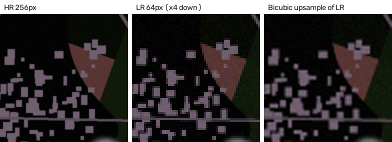

# satellite-tile-prep

[](https://github.com/RutuK2005/satellite-tile-prep/actions/workflows/ci.yml) [](LICENSE)

A small CLI that turns large satellite images into training data for super-resolution models. It cuts scenes into normalised, overlapping tiles, makes matching low-res/high-res pairs, and can stitch tiles (or a model's output tiles) back into one image.

At an ISRO hackathon our model needed satellite imagery prepared like this, and I did it with a pile of one-off scripts. This repo is the same steps redone as one tool with tests, so they can be rerun on new data.



Left to right: a 256px high-res tile, the 64px low-res input made from it, and a bicubic upscale of that input. The bicubic version is the baseline a super-resolution model has to beat.

## Running it

Python 3.10 or newer (CI runs 3.12 and 3.13).

```bash
python -m venv .venv
source .venv/bin/activate          # Windows: .venv\Scripts\activate
pip install -e ".[dev]"
```

If you don't have satellite data, the repo can generate fake scenes: 4 bands, 16-bit, with fields, roads, a river, a small town, some clouds and a black nodata corner.

```bash
python scripts/make_synthetic_scene.py --out data/scenes --count 3 --size 1536

tileprep stats data/scenes -o data/stats.json
tileprep tile data/scenes -o data/tiles --tile-size 256 --overlap 32 --stats data/stats.json --workers 3
tileprep pairs data/tiles -o data/pairs --scale 4 --noise 0.01 --augment 1
tileprep stitch data/tiles --scene synthetic_01 -o data/stitched/synthetic_01.tif --denormalize

python scripts/make_preview.py data/pairs --out examples/preview.png
```

The last command rebuilds the image above from the sharpest pair. `tileprep <command> --help` lists all the options. Tests and lint are `pytest` and `ruff check .`.

## How it works

**stats** fits a normalisation per band and saves it as JSON. By default each band is clipped to its 2nd and 98th percentile and scaled to 0-1; min-max and z-score are the other options. All three are stored as an offset and a scale per band, so you can reapply exactly the same transform at inference time and undo it afterwards. The numbers come from a random sample of up to 500k valid pixels per scene rather than every pixel. Given a folder, it fits one set of stats across all the scenes.

**tile** normalises each scene (with its own stats, unless `--stats` points at a file from the step above) and cuts it into square tiles that overlap their neighbours. If the image size doesn't divide evenly, the bottom and right edges are padded by mirroring instead of with zeros, because a black border would look like missing data. A tile is skipped when more than 20% of it is nodata, more than 30% of it is bright in every band (cloud), or its standard deviation after normalisation is under 0.02 (flat water, haze). Every tile, kept or not, goes into `manifest.csv` with its offsets, the skip reason and the numbers behind it. Scenes are processed in parallel in separate processes, and a scene that fails to load is logged and skipped so it doesn't kill the whole batch.

**pairs** makes the low-res input for each kept tile: a Gaussian blur as a rough stand-in for sensor blur, a bicubic downscale by 2, 3, 4 or 8, then optional noise. `--augment N` adds N rotated or flipped copies per tile. The same transform is applied to the LR and HR versions so the pixels stay aligned. Everything is listed in `pairs.csv`.

**stitch** puts tiles back together using the offsets in the manifest. In the overlaps, each tile's weight fades towards its edges, which hides seams better than a plain average. To stitch a model's outputs, save them under the same file names in a folder and pass `--tiles-from <folder>`. If they are a whole multiple of the input tile size (2x, 4x), the offsets are scaled to match. `--denormalize` converts back to the original units and dtype, and areas whose tiles were skipped come back as 0.

I used OpenCV rather than GDAL because it's much easier to install. It reads 8 or 16-bit images with up to 4 bands, and rasterio is only used, if it's installed, for files OpenCV can't open.

## Results on the synthetic scenes

This is what I get from the commands above:

- Each 1536x1536 scene becomes 49 tiles. 127 of the 147 are kept; 18 are skipped as nodata and 2 as cloud.
- `pairs --augment 1` writes 254 LR/HR pairs, one original and one augmented copy per kept tile.
- With `--method minmax --no-filter --nodata none`, tiling and then stitching with `--denormalize` gives back the original uint16 image exactly. The default percentile clipping can't do that, since values outside the clip range are thrown away on purpose.

The tests check the same things on small random images, plus a few that the demo doesn't show: stitching 2x upscaled tiles, parallel runs matching sequential ones, and LR/HR alignment after augmentation.

## Real data

Free Sentinel-2 scenes are on the [Copernicus Browser](https://browser.dataspace.copernicus.eu/). An 8-bit true-colour export works as is. For reflectance data, download bands B02, B03, B04 and B08 as 16-bit TIFFs and stack them:

```python
import numpy as np
from tileprep.io import load_image, save_image

bands = [load_image(f"download/{b}.tiff")[..., 0] for b in ["B02", "B03", "B04", "B08"]]
save_image("data/scenes/sentinel2.tif", np.dstack(bands))
```

For files with more than 4 bands, install the rasterio reader with `pip install -e ".[geo]"`.

## Limitations and next steps

- OpenCV doesn't keep georeferencing, so the outputs lose their coordinates. Keeping it when rasterio is installed is the next thing I'd add.
- The cloud rule is only "bright in every band". Clouds also push the 98th percentile up, so on cloudy scenes the land comes out dark (you can see it in the preview). Using Sentinel-2's own cloud mask (the SCL band) would fix both.
- Work is split per scene, so a single huge scene still runs on one core.
- Blur plus downscale is the usual way to fake LR data when there are no real pairs, but real sensor blur is different. It's worth trying a few `--blur-sigma` and `--noise` values instead of trusting one.
- A PyTorch `Dataset` that reads `pairs.csv` directly would make the pairs easier to train on.
